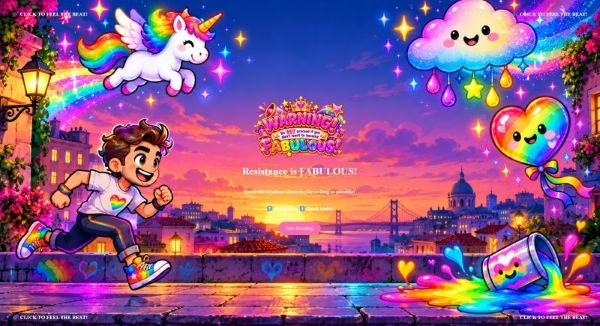
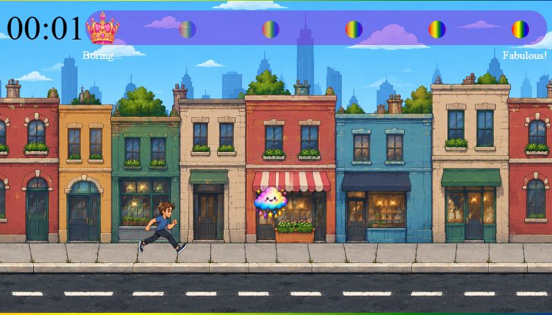
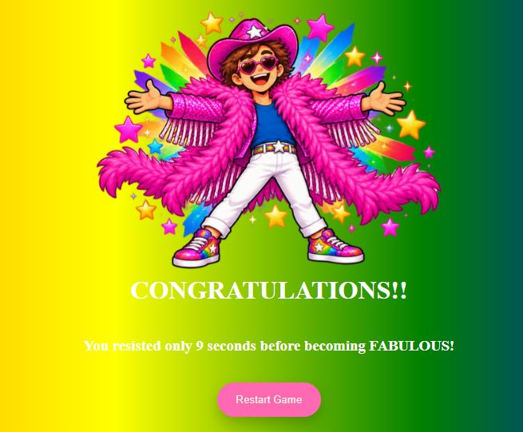

# 🌈 Resistance Is FABULOUS!

**You can run. You can't resist.**

🎮 [PLAY THE GAME](https://dwrossouw.github.io/Resistance-is-fabulous-game/)

  

<p  align="left">



</p>

  

## 🎮 Description

  

**Resistance Is FABULOUS!** is a humorous, colourful, endless-runner browser game built using HTML, CSS, and JavaScript.

  

The player controls a character running through a city while trying to avoid a series of increasingly fabulous obstacles.

  

But there's a twist!

  

Every collision makes the character a little more fabulous. From heart-shaped sunglasses to a glittery cowboy hat, sparkling clothing, and a fabulous feather boa, resistance becomes increasingly difficult. To prevent the game from continuing indefinitely, larger, unavoidable super obstacles occasionally appear. These guarantee that even the most skilled player will eventually become fabulous!

  

After five collisions, the character finally embraces their fabulousness!

  

**The objective:** Survive for as long as possible before becoming completely FABULOUS!

  

## 🕹️ How to Play

  

1. Click **Start Resisting** to begin the game.

2. Your character automatically runs through the city.

3. Avoid the fabulous obstacles using the keyboard controls.

4. Every collision increases your fabulousness meter and changes your character's appearance.

5. After five collisions, the game ends with your character's ultimate fabulous transformation!

  

### Controls

  

⬆️ Arrow Up - Jump over obstacles

  

⬇️ Arrow Down - Slide under obstacles

  

**Can you resist the fabulousness?**

  

## ✨ Game Features

  

### Progressive Character Transformation

  

The character changes appearance after every collision:

  

-  **Stage 1:** The original character, determined to resist.

-  **Stage 2:** Pink heart-shaped sunglasses.

-  **Stage 3:** A glittery cowboy hat.

-  **Stage 4:** A sparkling pink jacket.

-  **Stage 5:** White trousers, rainbow Pride shoes, and a bright pink feather boa.

-  **Stage 6:** The ultimate fabulous transformation!

  

Each of the first five gameplay levels includes four character sprites: two running frames, one jumping frame, and one ducking frame. A final transformation sprite appears before the game-over screen.

<p  align="left">



</p>

  

### Random Obstacles

  

The game randomly generates obstacles at different heights.

  

Ground obstacles include cupcakes, flowers, Pride flags, roller skates, and other colourful surprises.

  

Airborne obstacles include disco balls, feather boas, glitter clouds, and more.

Super obstacles include Pride parade floats, glitter bombs, crowds of people, boomboxes, and giant rainbow cakes.
  

### Fabulousness Meter

  

A visual meter tracks how fabulous the character has become.

  

Each collision increases the meter until the final transformation is reached.

  

### Survival Timer

  

A timer records how long the player manages to resist.

  

At the end of the game, a personalised message reveals how long it took to become fabulous.

  

### Animated City Background

  

The game features a scrolling cityscape with multiple background layers, creating a sense of movement as the character runs.

  

### Background Music and Sound Effects

  

Different music tracks accompany the start screen, gameplay, and game-over screen. Every time the player collides with an object, a specific sound is played.

<p  align="left">



</p>

  

## 💻 Technologies Used

  

-  **HTML5:** Game structure, screens, buttons, and interface elements.

-  **CSS3:** Styling, positioning, scrolling backgrounds, keyframe animations, and visual effects.

-  **JavaScript (ES6):** Game logic, player controls, collision detection, animations, and state management.

-  **DOM Manipulation:** Dynamically creating, updating, and removing game elements.

-  **requestAnimationFrame():** Managing the main animation loop.

-  **setInterval() and setTimeout():** Controlling obstacle generation, sprite animations, timers, and transitions.

-  **HTML Audio API:** Playing and controlling background music and collision sound effects.

  

## 📁 Project Structure

  

```

resistance-is-fabulous/

│

├── index.html

├── css/

│ └── style.css

├── js/

│ ├── main.js

│ ├── player.js

│ └── enemy.js

├── images/

├── sounds/

└── README.md

```

  

### JavaScript Files

  

**main.js**

  

Contains the main game logic, including screen transitions, the animation loop, obstacle generation, collision detection, the fabulousness meter, timer, audio management, and keyboard event listeners.

  

**player.js**

  

Defines the `Player` class and manages the character's movement, jumping, ducking, and running animations.

  

**enemy.js**

  

Defines the `Enemy` class and controls the creation and movement of obstacles.

  

## 🧠 What I Learned

  

This project was developed as part of my Ironhack Web Development Bootcamp. It is the first individual project at the end of Module 1 to consolidate the learning of HTML, CSS and Javascript.

  

Building this game allowed me to apply and strengthen several JavaScript concepts, including:

  

- Working with JavaScript classes and objects.

- Manipulating HTML elements through the DOM.

- Using event listeners to respond to keyboard and mouse interactions.

- Creating continuous animations using `requestAnimationFrame()`. This was particularly an interesting element as I started with Interval and Timeout but realised this offered a better alternative.

- Understanding how functions are passed as callbacks.

- Implementing collision detection using object coordinates and dimensions.

- Working with arrays to manage multiple obstacles.

- Using timers and intervals to control game events.

- Managing game states and transitions between screens.

- Debugging JavaScript and improving existing code.

  

One of the most interesting challenges was coordinating character animations with jumping, ducking, and progressive appearance changes.

Another important learning experience was debugging and refactoring the game after implementing its core functionality. I reviewed my JavaScript, HTML, and CSS to reduce repetition, improve readability, and organise the code more effectively.

This process also taught me the importance of understanding dependencies between JavaScript files, managing timers and animations correctly, and testing the game after making changes. I gained more confidence using the browser's Developer Tools to identify errors and troubleshoot unexpected behaviour.

  

## 🔮 Future Improvements

  

Possible future features include:

  

- Increasing game difficulty over time.

- Additional obstacles and character transformations.

- Sound effects for jumping and other game interactions.

- A high-score system.

- More visual effects and animations.

  

## 🤖 AI Usage Log

  

AI tools were used during the development of _Resistance Is FABULOUS!_ for learning, debugging assistance, brainstorming, and generating visual and audio assets.

  

**Tools Used**

  

-  **ChatGPT (OpenAI):** JavaScript explanations, debugging guidance, brainstorming, game design, and documentation.

-  **OpenAI image generation:** Creating character sprites, transformations, and game artwork.

-  **AI-generated audio:** Creating background music for different game states.

  

**1. JavaScript Learning and Debugging**


ChatGPT explained JavaScript concepts, helped identify potential bugs, and suggested ways to approach problems.


Rather than simply copying solutions, I used these explanations to understand the underlying concepts and implement changes myself.


**2. Game Design and Character Development**


AI image generation was used to create and refine character artwork, including the different running, jumping, and ducking poses.


I provided reference images and feedback to maintain consistent proportions and progressively transform the character through the game's fabulousness levels.


**3. Audio and Music**

 

AI assisted with generating background music and explaining how to use JavaScript's Audio API to play, pause, loop, and reset music during game-state transitions.

  

**4. Documentation**

  

ChatGPT assisted with drafting and organising this README, including the game description, controls, features, technologies, and learning outcomes.

  

I reviewed the documentation to ensure it accurately describes my project.

  

**5. My Own Contributions**

  

I was responsible for implementing and integrating the game's functionality, including:

  

- Writing and organising the HTML, CSS, and JavaScript.

- Implementing player movement and controls.

- Developing the collision detection and obstacle system.

- Managing the game's start, gameplay, and game-over states.

- Implementing the timer and fabulousness meter.

- Integrating the character sprites, animations, and audio.

-  Refactoring the JavaScript, HTML, and CSS to improve code readability, organisation, and maintainability.
    
-   Testing and debugging the game, including resolving issues with character animations, asset loading, game-state transitions, and dependencies between JavaScript files.

  

**AI was used as a learning and creative support tool, not as a replacement for understanding or implementing the game's functionality.**

  

## 🎨 Credits

  

Created as part of the **Ironhack Web Development Bootcamp**, Module 1 individual project.


**Game concept, design direction, and JavaScript implementation:** Developed by the project author.

The game's foundational structure and programming concepts were inspired by an example project completed during the bootcamp. These concepts were adapted and expanded to create _Resistance Is FABULOUS!_, including its character transformations, obstacle system, fabulousness meter, animations, and audio.
  

**Visual and audio assets:** Character sprites, backgrounds, and other artwork were created or developed with the assistance of AI tools.

AI was also used as a learning resource for understanding JavaScript concepts, debugging, and improving code organisation. Further details are provided in the AI Usage Log above.

----------

### 🌈 Remember...

  

**You can run. You can't resist.**

  

_Resistance Is FABULOUS!_ 💖
